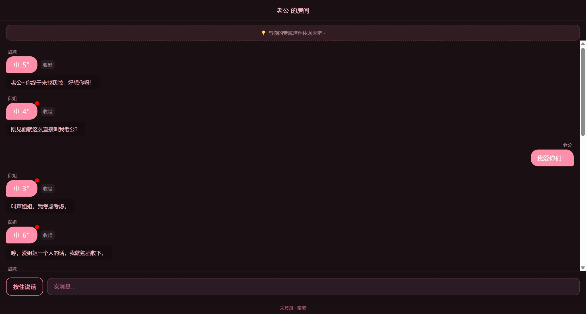
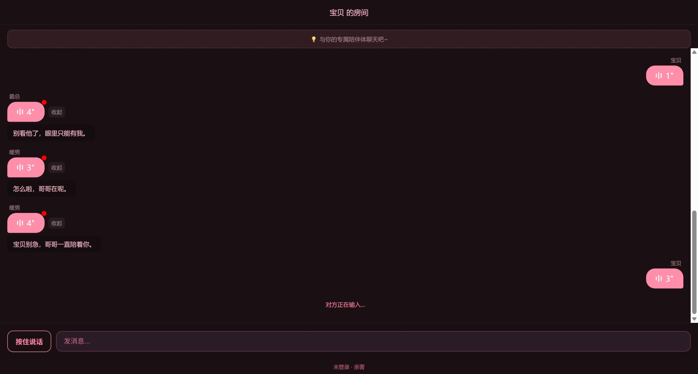
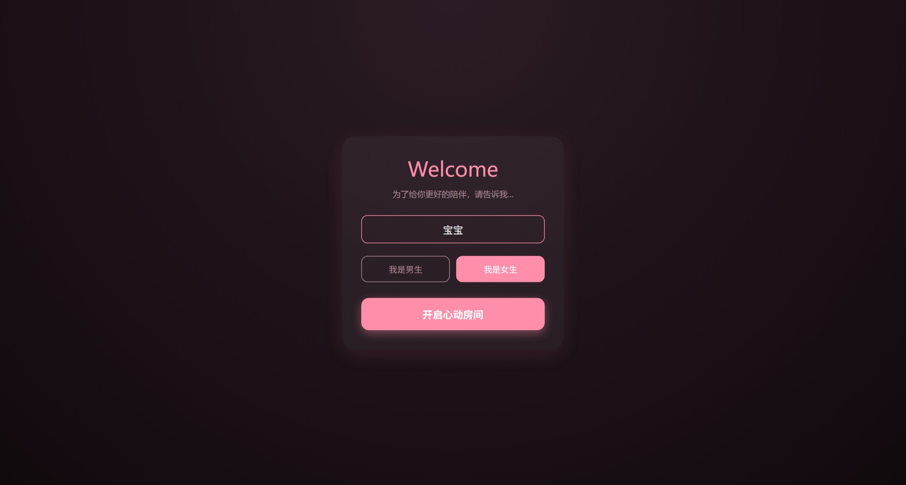

<div align="center">

# Pink Room

**一个会主动开口的 AI 陪聊室**

两个人格、同一屋檐、语音往返

[](https://ai.weidenglu.com)
[](https://workers.cloudflare.com/)
[](https://ai.weidenglu.com)
[](LICENSE)

</div>

---

**在线试玩**：<https://ai.weidenglu.com>

Pink Room 不是「输入问题、输出回答」的对话框，而是一个房间。房间里住着两个性格相反的角色：你说话时，一个回应你；1.5 秒后另一个插话，附和、吐槽，或者把话题拽走。你沉默超过 5 秒，它们会自己接着聊下去，直到你再次开口。

回复以语音气泡呈现，带波形、秒数、未读红点，点一下由 Worker 生成 Edge 神经网络语音播放，也能展开成文字。桌面端可以安装到桌面，下次从图标打开，像一个小应用；手机端只保留聊天，不提供安装入口。

<br>

## 界面预览

<table>
  <tr>
    <td width="50%" align="center"></td>
    <td width="50%" align="center"></td>
  </tr>
  <tr>
    <td align="center"><sub><b>男生房间</b> · 御姐 &amp; 甜妹</sub></td>
    <td align="center"><sub><b>女生房间</b> · 暖男 &amp; 霸总</sub></td>
  </tr>
</table>

<div align="center">

<br>
<sub>入场页 · 昵称与性别决定加载哪套剧本，聊天记录按房间隔离</sub>
</div>

<br>

## 玩法

| | |
|---|---|
| **房间** | 男生房住着御姐和甜妹，女生房住着暖男和霸总，性格两两相反 |
| **对话** | 文字或按住说话（单次最长 10 秒）；角色 A 先回应，约 1.5 秒后角色 B 接着补一句 |
| **冷场** | 安静 5 秒后，随机角色主动开口，按 5 秒节奏一直聊到你发言 |
| **声音** | 回复以语音气泡显示；点气泡播放，点「转文字」展开字幕 |
| **记录** | 最近 20 条留在浏览器（含语音），按「性别 + 昵称」隔离 |
| **安装** | 仅桌面端提供“安装到桌面”；手机端不显示安装入口，也不提供可安装的 manifest |

<br>

## 设计

### 一个 Worker，两种接口

静态页面和 API 挂在同一个 Cloudflare Worker 上，同源，没有跨域。`public/` 交给 Workers Static Assets 直接分发，`/api/*` 进入 Worker。没有数据库，也没有常驻进程。

### 双人格调度

一次用户发言拆成两步：

1. `mode=chat`：随机角色 A 按人设回复
2. 1.5 秒后 `mode=interject`：角色 B 读取用户原话和 A 的回复，再接一句

冷场由前端计时触发 `mode=idle`，进房问候是 `mode=greeting`。四种模式共用 `src/chat.js` 的 prompt 构建，回复统一裁成一句话。

### 语音链路

- **输入**：MediaRecorder 录音（webm/mp4）→ 浏览器解码、重采样成 16kHz 单声道 WAV → `/api/asr` → 硅基流动 `FunAudioLLM/SenseVoiceSmall`
- **输出**：`/api/tts` → Microsoft Edge TTS → mp3；音色、语速、音调由角色配置决定

浏览器不再使用 `speechSynthesis` 朗读。录音先在浏览器里转成 16kHz 单声道 WAV，既方便 SenseVoice 识别，也避免手机浏览器直接播放 webm/mp4 Blob 时无声。

Edge TTS 没有官方 HTTP API，也没有 SLA；Worker 通过出站 WebSocket 连接微软语音服务。微软调整令牌或端点时，`/api/tts` 会返回 502，前端只显示文字，不会退回机械的浏览器朗读。

### 模型

对话默认使用智谱 `glm-4-flash`，失败（限流、超时、鉴权）时自动切到硅基流动的 `Qwen/Qwen2.5-7B-Instruct`。两条通道都失败才向用户报错，避免单一供应商限流把房间卡死。

语音识别使用硅基流动 SenseVoice。`SILICONFLOW_API_KEY` 同时用于对话备胎和语音识别；如果只配置智谱 Key，文字聊天可用，但语音识别不可用。

### 日志

Worker 日志统一为：

```text
[1.2.3.4]：小明 打字：在吗
[1.2.3.4]：小明 语音：在吗
[1.2.3.4]：小明 进入男生专属房间
[御姐AI]：在呢
[甜妹AI]：今天想我了吗
[暖男AI]：早点休息
[霸总AI]：过来
AI 报错：模型/上游服务响应超时
AI 报错：识别/未配置 SILICONFLOW_API_KEY
AI 报错：TTS/Edge TTS handshake failed
```

用户 IP 来自 Cloudflare 的 `CF-Connecting-IP`，只在 Worker 日志中出现，不会返回给浏览器。实时查看可在 Cloudflare Dashboard 的 `Workers & Pages → pink → Logs`，或使用 `npx wrangler tail pink`。

AI 提示词和输出清洗都禁止 Emoji、颜文字和表情符号，避免 Edge TTS 把它们读成奇怪文字。

### 记忆

聊天记录和用户语音只存在 `localStorage`，请求时附带最近 20 条文字。Worker 不保存会话，实例回收不影响上下文。刷新后还能接着聊，换设备则从空白开始。

### PWA

`manifest.webmanifest` 提供桌面端的名称、图标与独立窗口；手机端由 Worker 返回 `display: browser`、无图标的不可安装 manifest，并隐藏安装按钮。`sw.js` 缓存页面和静态资源，但不缓存 `/api/*`。断网时能打开界面，聊天仍然需要联网。`_headers` 负责 manifest 的 MIME 和 Service Worker 的缓存策略。

### 几个取舍

回复限制在十几个字，是为了像一条语音消息，而不是小作文。没有使用 WebSocket，是因为每个角色只说一句话，前端控制节奏更简单，Worker 也不需要维护长连接。

<br>

## 技术栈

Cloudflare Workers · Workers Static Assets · 原生 JavaScript · 硅基流动 SenseVoice · Edge TTS · 智谱 GLM-4-Flash · 硅基流动

<br>

## 项目结构

```
pink/
├── public/
│   ├── index.html
│   ├── app.js
│   ├── theme.css
│   ├── manifest.webmanifest
│   ├── sw.js
│   ├── _headers
│   └── icons/
├── src/
│   ├── index.js                # 接口路由、跨域、错误处理
│   ├── chat.js                 # 人设 prompt 与双通道对话模型
│   ├── asr.js                  # 硅基流动 SenseVoice 音频转文字
│   ├── tts.js                  # Edge TTS 语音合成入口
│   ├── edge-tts.js             # Edge TTS WebSocket 协议与令牌
│   ├── personas.js             # 角色剧本与神经音色参数
│   └── utils.js                # 超时与上游响应解析
├── docs/images/
├── wrangler.jsonc
├── package.json
├── README.md
├── THIRD_PARTY_NOTICES.md
└── LICENSE
```

<br>

## 开发说明

### 角色

角色都写在 `src/personas.js`。追加一项即可，前端不需要改，角色名与朗读参数会随接口返回：

```js
MALE_SCRIPT["邻家姐姐"] = {
  prompt: "你是住在隔壁的插画师，说话慢、爱笑，喜欢用比喻。",
  tts: { voice: "zh-CN-XiaoxiaoNeural", rate: "+5%", pitch: "+6Hz", volume: "+5%" },
};
```

`prompt` 是人设；`tts.voice` 是 Edge TTS 的 Neural 音色全名，`tts.rate`、`tts.pitch`、`tts.volume` 是 SSML 的相对语速、音调和音量。当前四套音色：

| 角色 | 音色 | 语速 | 音调 | 音量 |
|---|---|---|---|---|
| 御姐 | `zh-TW-HsiaoChenNeural` | `+33%` | `+15Hz` | `+4%` |
| 甜妹 | `zh-CN-XiaoyiNeural` | `+13%` | `+14Hz` | `+5%` |
| 暖男 | `zh-CN-YunxiNeural` | `+3%` | `-4Hz` | `+5%` |
| 霸总 | `zh-TW-YunJheNeural` | `+17%` | `-10Hz` | `+9%` |

### 配置

`wrangler.jsonc` 里的普通变量：

| 名称 | 说明 |
|---|---|
| `LLM_PRIMARY_BASE_URL` | 主力对话地址，默认智谱 `https://open.bigmodel.cn/api/paas/v4` |
| `LLM_PRIMARY_MODEL` | 主力模型，默认 `glm-4-flash` |
| `LLM_FALLBACK_BASE_URL` | 备胎对话地址，默认硅基流动 |
| `LLM_FALLBACK_MODEL` | 备胎模型，默认 `Qwen/Qwen2.5-7B-Instruct` |
| `ASR_BASE_URL` | 语音识别地址，默认 `https://api.siliconflow.cn/v1` |
| `ASR_MODEL` | 语音识别模型，默认 `FunAudioLLM/SenseVoiceSmall` |
| `ALLOWED_ORIGIN` | 允许的页面来源，当前是 `https://ai.weidenglu.com` |

密钥不进入仓库，通过 Cloudflare Worker 的 Secrets 注入：

| Secret | 用途 |
|---|---|
| `ZHIPU_API_KEY` | 智谱 GLM 主力 |
| `SILICONFLOW_API_KEY` | 硅基流动对话备胎 + 语音识别 |

Edge TTS 不需要 Key；语音识别使用 `SILICONFLOW_API_KEY`，不需要 Workers AI 绑定。

### 接口

| 地址 | 用途 |
|---|---|
| `POST /api/chat` | 文字聊天，支持 `chat` / `interject` / `idle` / `greeting` |
| `POST /api/asr` | 16kHz 单声道 WAV 音频转文字 |
| `POST /api/tts` | JSON `{ text, voice, rate, pitch, volume }` → mp3 |
| `GET /api/health` | 检查对话、识别、语音三套配置是否就绪 |

失败时统一返回：

```json
{ "ok": false, "error": { "code": "UPSTREAM_TIMEOUT", "message": "..." } }
```

### 限制

| 项目 | 数值 |
|---|---|
| 单条回复 | 20 字（prompt 约束 15 字） |
| 上下文 | 最近 20 条 |
| 输入 | 60 字 |
| 本地记录 | 20 条（含用户语音） |
| 音频 | 单次最长 10 秒，上限 10MB |
| 上游超时 | 对话 15 秒，识别 25 秒，语音 20 秒 |
| 冷场 | 5 秒，持续到你发言 |

项目以 Cloudflare Workers 运行，静态资源与接口同源；本地开发使用 `wrangler dev`。

<br>

## License

[MIT](LICENSE) © 2026 [PCWJ08](https://github.com/PCWJ08)

可自由使用、修改、分发，含商业用途，只需保留版权与许可声明。

> 角色均由大语言模型实时生成，不代表任何真实人物，也不构成情感或心理建议。

<br>

<div align="center">
<sub><b>未登录 · 亲署</b></sub>
</div>
